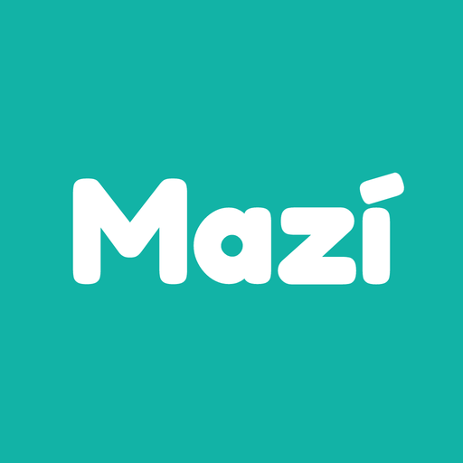
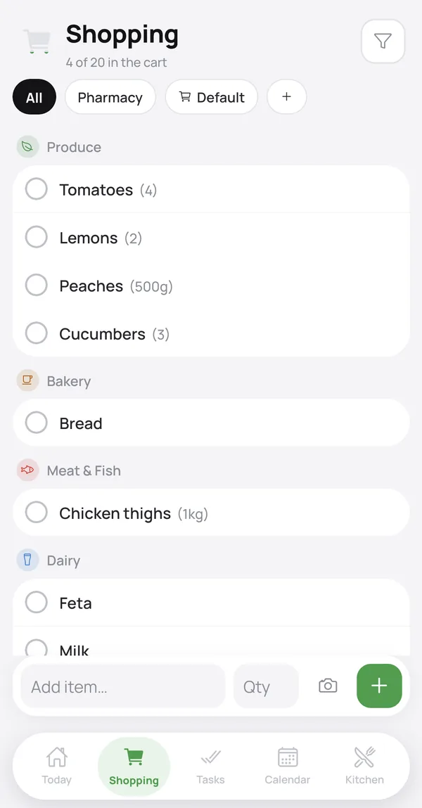

# meetmazi.com Redesign Implementation Plan

> **For agentic workers:** REQUIRED SUB-SKILL: Use superpowers:subagent-driven-development (recommended) or superpowers:executing-plans to implement this plan task-by-task. Steps use checkbox (`- [ ]`) syntax for tracking.

**Goal:** Give every page of meetmazi.com the new sticker look, with the í mascot, a day/night switch and the new homepage,
without changing any address, the `/join` logic, or the content search engines read.

**Architecture:**
- **No build step.** The site stays plain HTML files that Cloudflare serves as they are.
- **Shared files:** one stylesheet (`assets/site-1.css`), one ES module for every page (`assets/site-1.js`: theme
  switch and reveals), and one module that draws the í and the letters (`assets/mascot-1.js`). The mascot module is
  loaded only where a page has a mascot.
- **Homepage files:** `assets/home-1.css` and `assets/home-1.js` add the homepage's interactive sections.
- **Theme before paint:** a tiny inline script in every `<head>` sets the theme before the page draws.
- **Tests:** written with Node's built-in test runner. They drive headless Chrome over the DevTools protocol and compare
  each page with its pre-redesign version from git.

**Tech Stack:**
- Site: HTML, CSS, vanilla JS (ES modules).
- Tests: Node 24 (`node:test`, global `WebSocket`, `node:zlib`) and Chrome. No npm dependencies. Lighthouse runs once,
  through `npx`, in the last task.

**Spec:** `docs/superpowers/specs/2026-11-04-site-redesign-design.md`, with the mockup beside it
(`2026-11-04-site-redesign-mockup.html`). Read both before starting. The mockup's script holds the í drawing code
(`POSES`, `FACES`, `iSvg`, `letterSvg`, `dress`, `Buddy`, the sorter), which the tasks below port.

## Global Constraints

### Hosting and files

- **Branch:** work on `site-redesign`. Never push `main`, because a push to `main` publishes the site.
- **Addresses stay:** `/`, `/faq`, `/shopping-list`, `/chores`, `/meal-planner`, `/family-calendar`, `/privacy`,
  `/terms`, `/delete-account`, `/join`, `/tiktok`, and the 404 page. Leave `_redirects`, `_headers` and
  `wrangler.jsonc` untouched.
- **Head stays as it is:** title, meta description, canonical, every `og:` tag and every JSON-LD block stay
  byte-identical to the baseline (`git merge-base HEAD main`). Only the `theme-color` metas, the font preloads, the
  stylesheet and script tags change.
- **`/join` script:** the `<script>` block in `join.html` stays byte-identical. Every id it uses stays:
  `invite code copy bad android android-open play apple ios ios-open desktop step-code`.
- **Third parties:** no third-party scripts, fonts or CDNs. Fonts come from `/assets/fonts/`.
- **File names:** new CSS/JS files carry a version number (`site-1.css`, `site-1.js`, `mascot-1.js`, `home-1.css`,
  `home-1.js`). `_headers` lets browsers keep `/assets/*` for a day plus a week, so a later change gets a new number.
- **Asset paths:** every page references assets by absolute path (`/assets/...`), so the 404 page works at any depth.
- **Not published:** `docs` and `tests` must be listed in `.assetsignore`.

### Content rules

- **No free text:** no `<input>`, `<textarea>` or `contenteditable` anywhere. Every interaction is a `<button>`.
- **Claims:** only claim what the app does. Sofia is an adult. Children appear only as calendar events.
- **Store badges:** store links use the official images `/assets/google-play-badge.png` and
  `/assets/app-store-badge.svg`.

### Look and theme

- **Colours (day):**
  - `--bg #FFF7EC`, `--fg #1F2D3A`, `--muted #56636f`, `--card #fff`, `--blob #12B3A6`, `--line #1F2D3A`
  - `--soft #EEF8F6`, `--hi #FFE9A8`, `--accent #0D8478`
  - `--tint1 #E3F5F1`, `--tint2 #FFF1C9`, `--tint3 #FDE2E4`, `--tint4 #E9E4FB`
- **Colours (night):**
  - `--bg #141E33`, `--fg #F3EEDF`, `--muted #AEB8C8`, `--card #1F2B45`, `--blob #0B7B72`, `--line #070C18`
  - `--soft #26375A`, `--hi #2E2A55`, `--accent #3FD3C3`
  - `--tint1 #17364A`, `--tint2 #3A3350`, `--tint3 #3E2C45`, `--tint4 #2B2F57`
- **Contrast:**
  - Ink text (`#1F2D3A`) on teal `#12B3A6`.
  - Small accent text uses `--accent-text`, at least 4.5:1 on `--bg` and on `--hi`. Day value: the implementer's
    choice, darker than `#0D8478`. Night value: `#3FD3C3`.
  - The crossed-out "group chat" grey: at least 3:1.
- **Mascot colours:** ink `#1F2D3A`, teal `#12B3A6`, cheek `#FF8FA3`. Members: George `#3B5BDB`, Maria `#E64980`,
  Sofia `#E8590C`.
- **Theme storage:** `localStorage` key `mazi-theme`, values `day` or `night`. The theme sits on `<html data-theme>`.
- **Motion:** `prefers-reduced-motion: reduce` means no motion, and content appears in its final state.

### Tests

Run the suite with `node --test --test-concurrency=1 "tests/*.test.mjs"`. Run one file with
`node --test --test-concurrency=1 tests/<name>.test.mjs`. Concurrency 1 keeps a single Chrome running at a time.

### Commits

Every commit message ends with these two lines:

```
Co-Authored-By: Claude Opus 5.5 <noreply@anthropic.com>
Claude-Session: https://claude.ai/code/session_01U5mBx97uHyEQmFarBrxWMz
```

## Review Focus

These are the five conditions the spec implies but does not spell out. Each has a test in the task that owns the code.

1. **A browser that throws on `localStorage`** (Safari with storage blocked, some private modes): the page loads, the
   switch still flips the colours for that page, and nothing is thrown. Tested in Task 2.
2. **The system theme changes while a page is open and the visitor never used the switch:** the page follows. Tested in
   Task 2.
3. **The sorter button pressed several times during its animation:** no duplicate rows, no stuck clones, and it ends
   in a consistent state. Tested in Task 7.
4. **Fredoka fails to load:** the letters still draw in the fallback font without errors, and nothing shifts. Tested in
   Task 3.
5. **Jumping to `#get` (the "Get the app" button) or any anchor:** the target is not hidden under the sticky header.
   Tested in Task 6.

---

### Task 1: Test harness

**Files:**
- Create: `tests/serve.mjs`, `tests/browser.mjs`, `tests/baseline.mjs`, `tests/pages.mjs`, `tests/harness.test.mjs`
- Modify: `.assetsignore` (add `tests`)

**Interfaces:**

Produces `tests/serve.mjs`:

- `startServer({ port = 0, fixtures = false } = {}): Promise<{ origin: string, close(): Promise<void> }>`
  - Serves the repo root the way Cloudflare does:
    - `/` → `index.html`.
    - `/<name>` → `<name>.html` when that file exists.
    - Other existing files are served as they are.
    - The `301` lines of `_redirects` are honoured.
    - Anything else, or any path under an `.assetsignore` entry, gets `404.html` with status 404.
  - Sends `Content-Encoding: br` to clients that accept it, for html/css/js/svg/json/txt/xml.
  - Refuses path traversal.
  - With `fixtures: true`, also serves `tests/fixtures/` at `/__test/`.
- CLI: `node tests/serve.mjs` listens on 8788 and prints `http://localhost:8788`. This is how Giorgos clicks through
  the branch.

Produces `tests/browser.mjs`:

- `launch(): Promise<Browser>`
  - Starts Chrome (`process.env.CHROME`, defaulting to `C:/Program Files/Google/Chrome/Application/chrome.exe`) with
    `--headless=new --remote-debugging-port=0` and a fresh profile from `fs.mkdtemp(os.tmpdir())`.
  - Reads the port from `<profile>/DevToolsActivePort`.
  - All pages of one `Browser` share `localStorage`.
- `Browser.newPage({ width = 1280, height = 900, mobile = false, colorScheme, reducedMotion = false, javascript = true, userAgent, blockUrls = [], initScript } = {}): Promise<Page>`
  - Applies `Emulation.setDeviceMetricsOverride`, `setEmulatedMedia` (`prefers-color-scheme`,
    `prefers-reduced-motion`), `setScriptExecutionDisabled`, `setUserAgentOverride`, `Network.setBlockedURLs` and
    `Page.addScriptToEvaluateOnNewDocument(initScript)`.
- `Page.goto(url): Promise<{ status: number }>`
  - Waits for `load` plus 300 ms.
  - The status comes from the main document's `Network.responseReceived`.
- `Page.eval(expr: string): Promise<any>`: `Runtime.evaluate` with `awaitPromise` and `returnByValue`. A thrown
  exception rejects.
- `Page.click(selector)` and `Page.hover(selector)`: scroll the element into view, then dispatch real mouse events at
  its centre.
- `Page.media({ colorScheme, reducedMotion })`: changes the emulated media mid-page.
- `Page.errors: string[]`: exceptions, console errors and failed requests, except `/favicon.ico`.
- `Page.shot(path)` and `Page.close()`.
- `Browser.close()`.

Produces `tests/baseline.mjs`:

- `baseline(file: string): string`: the file at `git merge-base HEAD main`, read with `git show`.
- `headParts(html: string): { title, description, canonical, og: Record<string,string>, jsonld: string[] }`
- `mainBlocks(html: string): string[]`: the text of every `h1,h2,h3,h4,p,li` inside `<main>`, tags stripped, entities
  decoded, whitespace collapsed, empty strings dropped.
- `hrefs(html: string): string[]`: every `href` in `<body>`.

Produces `tests/pages.mjs`:

- `PAGES: Array<{ path, file, kind, pose?, prop? }>`. Each later task appends its pages.
- `BOOT: string`, the exact inline head script, copied from Task 2.

- [ ] **Step 1: Write `tests/harness.test.mjs`**

The tests run against today's site:

- `serves pages without .html`: `/faq` gives 200 and its body contains `Questions about Mazí`.
- `redirects .html addresses`: `/faq.html` gives 301 with `Location: /faq`.
- `unknown addresses get the 404 page`: `/nope/deeper` gives 404 and its body contains `There is no page here`.
- `does not publish docs or tests`: `/docs/superpowers/specs/2026-11-04-site-redesign-design.md` and
  `/tests/serve.mjs` both give 404.
- `compresses text`: `/` with `Accept-Encoding: br` comes back with `content-encoding: br`.
- `the browser loads the homepage cleanly`: `launch()` → `goto(origin + '/')` gives status 200, and `page.errors` is
  `[]`.
- `baseline reads the old homepage`: `headParts(baseline('index.html')).canonical === 'https://meetmazi.com/'`.

- [ ] **Step 2:** Run `node --test --test-concurrency=1 tests/harness.test.mjs`. It should fail because the modules do
  not exist yet.
- [ ] **Step 3:** Implement the four modules as specified, and add `tests` to `.assetsignore`, under its comment about
  files that are not part of the site.
- [ ] **Step 4:** Run the same command. It should pass all 7 tests.
- [ ] **Step 5:** Commit: `test: a local server that serves the site like Cloudflare, and a Chrome driver for checking
  pages`.

---

### Task 2: The new look's foundation, on the privacy, terms and delete-account pages

**Files:**
- Create:
  - `assets/site-1.css`: fonts, tokens, base type, header, switch, buttons, badges, bands, sticker cards, reveal, the
    article layout, and the footer.
  - `assets/site-1.js`
  - `tests/static.test.mjs`
  - `tests/site.test.mjs`
  - `tests/contrast.mjs`
- Modify:
  - `privacy.html`, `terms.html`, `delete-account.html`: their head links, header and footer.
  - `tests/pages.mjs`: add `{ path: '/privacy', file: 'privacy.html', kind: 'legal' }` and the same for terms and
    delete-account, then set `BOOT`.

**Interfaces:**

Produces the exact boot script. It goes in every page's `<head>`, after the metas and before the first stylesheet:

```html
<script>(function(d){var t;try{t=localStorage.getItem('mazi-theme')}catch(e){}if(t!=='day'&&t!=='night')t=matchMedia('(prefers-color-scheme: dark)').matches?'night':'day';d.dataset.theme=t;d.classList.add('js')})(document.documentElement)</script>
```

Produces the header markup used on every page (except `/join`, see Task 5):

```html
<header class="top">
  <a class="brand" href="/"><span>Mazí</span></a>
  <nav class="nav" aria-label="Mazí"><a href="/shopping-list">Shopping</a><a href="/chores">Tasks</a><a href="/meal-planner">Meals</a><a href="/family-calendar">Calendar</a><a href="/faq">FAQ</a></nav>
  <button class="switch" id="theme-switch" type="button" aria-label="Night colours" aria-pressed="false"></button>
  <a class="get-btn" href="#get">Get the app</a>
</header>
```

- `href="#get"` applies on pages that have an element with `id="get"`. Elsewhere it is `/#get`.
- Each page's footer keeps its own links as they are today, restyled.

Produces `assets/site-1.css`:

- **Tokens:** the day tokens from Global Constraints go on `:root`, plus `--accent-text` and `--shadow`. The night
  tokens go on `:root[data-theme="night"]` and, without JavaScript, inside
  `@media (prefers-color-scheme: dark) { :root:not([data-theme]) { … } }`. The two night blocks are identical.
- **Classes:** `.wrap`, `.top`, `.brand`, `.nav`, `.switch`, `.get-btn`, `.band`, `.band-yellow` (`--hi`), `.eyebrow`
  (`--accent-text`), `.sec-lead`, `.sticker`, `.badges`, `.badge`, `.get`, `.article`, `.updated`, `.box`, `.qa`,
  `footer`, `.reveal`, `.reveal.pending`.
- **Rules:**
  - `.switch` is hidden unless `html.js`.
  - Below 720px, `.nav` is hidden.
  - `html { scroll-padding-top: <header height + 16px> }`.
  - A visible `:focus-visible` outline on links and buttons.
  - Under reduced motion, every animation and transition is off.

Produces `assets/site-1.js` (ES module), which runs on import:

- **`setupThemeSwitch(): void`**
  - `#theme-switch` shows `aria-pressed="true"` at night.
  - A click flips `html[data-theme]` and saves the choice in `localStorage` inside `try`/`catch`.
  - It sets both `meta[name=theme-color]` contents to `#FFF7EC` or `#141E33`.
  - It dispatches `document` event `mazi:theme` with `detail: { theme, byUser: true }`.
  - With no stored choice, it listens to `matchMedia('(prefers-color-scheme: dark)')` changes and follows them. Those
    dispatch `byUser: false`.
- **`setupReveal(): void`**
  - Under reduced motion it does nothing.
  - Otherwise, each `.reveal` whose top is below the viewport gets `.pending` and is observed. On intersecting,
    `.pending` is removed.
  - Elements already in view are never hidden.
- **The mascot:** if the page has `[data-i-pose]`, it calls `import('./mascot-1.js').then(m => m.drawAll())`. That
  module comes in Task 3, so until then the call never runs.

Produces `tests/contrast.mjs`:

- `CONTRAST_JS: string`, an expression that returns `Array<{ text, ratio, need }>`.
- It checks every visible element with a direct non-empty text node that is not inside `[aria-hidden="true"]`:
  - The foreground is the computed `color`.
  - The background is the nearest ancestor with a non-transparent `background-color`, alpha-blended over the next one
    down to `body`.
  - `need` is 3 for text of at least 24px, or at least 18.66px with weight 700 or more. Otherwise it is 4.5.
  - It returns the failures.

- [ ] **Step 1: Write `tests/static.test.mjs`**

These tests loop over `PAGES` and read files from disk:

- `<file>: head is unchanged`: `headParts(new)` deep-equals `headParts(baseline(file))`.
- `<file>: has the boot script once, before the stylesheet`: `BOOT` occurs once, at an index lower than
  `<link rel="stylesheet" href="/assets/site-1.css">`.
- `<file>: uses no old stylesheet`: the page does not contain `article.css` or `feature.css`.
- `<file>: text is preserved`: every entry of `mainBlocks(baseline(file))` is in `mainBlocks(new)`. The homepage gets
  an allowlist in Task 6.
- `<file>: links are preserved`: every entry of `hrefs(baseline(file))` is in `hrefs(new)`. For a page without
  `id="get"`, `#get` may become `/#get`.
- `<file>: no free text`: the page does not match `/<input|<textarea|contenteditable/i`.
- `<file>: assets are absolute`: the page does not match `/(src|href|srcset)="\.?\/?assets\//` without a leading `/`.
- `<file>: store links use the official badges`: every `<a>` whose href contains `play.google.com` or
  `apps.apple.com` contains `google-play-badge.png` or `app-store-badge.svg`.
- `<file>: nothing loads from another site`: no `<script src="http`, and no `<link>` with `rel` of `stylesheet`,
  `preload` or `modulepreload` whose `href` starts with `http`.
- `site-1.css: the two night blocks match`: extract both blocks' declarations and check they are equal.

- [ ] **Step 2: Write `tests/site.test.mjs`**

These tests loop over `PAGES`, with one browser per file:

- `<path>: no errors, day and night, desktop and 360px phone`: four page setups (`colorScheme` light/dark ×
  `width` 1280/360 with `mobile`). For each:
  - The `goto` status is 200, or 404 for `kind: '404'`.
  - `errors` is `[]`.
  - `document.documentElement.scrollWidth <= innerWidth`.
  - `document.documentElement.dataset.theme` is `day` or `night` to match.
- `<path>: readable without JavaScript`: with `javascript: false`:
  - The `h1` has a non-zero box.
  - `document.querySelectorAll('.pending').length === 0`.
  - `getComputedStyle(#theme-switch).display === 'none'`.
- `<path>: contrast passes, day and night`: `eval(CONTRAST_JS)` gives `[]` in both themes.
- `<path>: reduced motion stops everything`: with `reducedMotion: true`, after 1s
  `document.getAnimations().filter(a => a.playState === 'running').length === 0`.

Theme tests, run once on `/privacy`:

- `the switch flips and remembers`:
  - Light system, click `#theme-switch`. Then `data-theme === 'night'`, `aria-pressed === 'true'`,
    `localStorage['mazi-theme'] === 'night'`, and the `theme-color` meta is `#141E33`.
  - Open `/terms` in the same browser: it is night.
- `a stored choice beats the system`: store `day`, open with `colorScheme: 'dark'`. Then `data-theme === 'day'`.
- **Review Focus 1, `storage that throws does not break the switch`:**
  - Run with `initScript` that redefines `localStorage` to throw on access: `Object.defineProperty(window, 'localStorage', { get() { throw new Error('blocked') } })`.
  - Then `errors` is `[]`, a click on the switch flips `data-theme`, and a second click flips it back.
- **Review Focus 2, `follows the system while no choice is stored`:** open with light, then
  `media({ colorScheme: 'dark' })`. Then `data-theme === 'night'` within 500 ms.

- [ ] **Step 3:** Run both files. They should fail because the pages still use `article.css` and there is no switch.
- [ ] **Step 4:** Write `assets/site-1.css` and `assets/site-1.js` as specified.
  - Take the look from the mockup's `#s` rules: the sticky blurred header, ink borders and hard offset shadows on
    `.sticker`, and Fredoka headings.
  - Take the article and table rules from today's `assets/article.css`, restyled with the new tokens.
- [ ] **Step 5:** Convert `privacy.html`, `terms.html` and `delete-account.html`.
  - Head: the boot script, then the Fredoka and Atkinson 400 preloads with absolute paths, then
    `<link rel="stylesheet" href="/assets/site-1.css">`, then `<script type="module" src="/assets/site-1.js"></script>`.
  - Set the theme-color metas to `#FFF7EC` (light) and `#141E33` (dark).
  - Use the shared header with `/#get`.
  - Keep `<main class="article">` and its contents unchanged, apart from absolute asset paths.
  - Restyle the footer.
  - No mascot.
- [ ] **Step 6:** Run both files. They should pass. Look at
  `page.shot('C:/Users/Giorgos/AppData/Local/Temp/mazi-shots/privacy-day.png')` and the night version, and check that
  the page reads calmly: plain text, no animation.
- [ ] **Step 7:** Commit: `feat: the new look's colours, header, day/night switch and footer, first on the privacy,
  terms and delete-account pages`.

---

### Task 3: The í and the letters

**Files:**
- Create: `assets/mascot-1.js`, `tests/fixtures/mascot.html`, `tests/mascot.test.mjs`
- Modify: `assets/site-1.css`. Add the `.fi`, `.say` (speech bubble), `.say.show`, `.hop` (keyframes), `.blink`
  (keyframes), `.prop`, `.thought` and `.cl`/`.ci` rules from the mockup, plus the night drop-shadow on mascot SVGs:
  `filter: drop-shadow(0 0 1.6px rgba(243,238,223,.75))` under `[data-theme="night"]`.

**Interfaces:**

Produces `assets/mascot-1.js` (ES module):

- **Constants:**
  - `INK`, `TEAL`, `CHEEK`: the mascot colours from Global Constraints.
  - `MEMBER_COLOURS = { George: '#3B5BDB', Maria: '#E64980', Sofia: '#E8590C' }`.
  - `POSE_NAMES = ['idle','wave','joy','cheeky','surprised','sleepy','phone','strain','sad','push','stir','awake','dizzy']`.
  - `DEFAULT_REACTIONS = [['joy','hi! 👋'], ['cheeky','hehe'], ['surprised','oh! you again']]`.
- **`iSvg(pose: string): string`**
  - Returns `<svg viewBox="0 0 220 240" aria-hidden="true" …>`, ported from the mockup's `iSvg`, `POSES`, `FACES` and
    `armSvg`.
  - Add `dizzy`: the face from `../mazi-promo/src/mascot/figure.ts` (`case 'dizzy'`) and the arms from `MOODS.dizzy`
    (`arm([87,142],[62,152],[52,134])` and `arm([133,142],[158,152],[168,134])`).
  - It throws `Error('unknown pose: ' + pose)` for any other name.
- **`letterSvg(ch: string): string`**, ported from the mockup.
- **`dressLetter(box: Element, colour: string): void`**
  - Ported from the mockup's `dress`.
  - It returns without throwing if `getBBox` fails or is empty.
- **`propHtml(name: 'trolley' | 'tower' | 'pot' | 'thoughts'): string`**
  - The trolley, task tower and steaming pot are the mockup's inline SVGs, with class `prop` and `aria-hidden="true"`.
  - `thoughts` is the three `.thought` bubbles ⚽ 🦷 🎂.
- **`class Buddy`**
  - `constructor(el: HTMLElement, base: string, bubble?: HTMLElement | null)`
  - Fields: `el`, `base`, `pose`.
  - `set(pose): void` redraws and sets `el.dataset.pose`.
  - `act(pose, ms = 1600, text?): void` sets the pose, adds `.hop`, shows `text` in the bubble, and returns to `base`
    after `ms`.
  - `say(text, ms = 1800): void`
- **`startLooking(): void`**
  - Idempotent.
  - On pointer move or scroll (throttled with `requestAnimationFrame`), every `[data-looker]` element's `.look` group
    moves up to `data-max` (default 3.2) toward the pointer.
- **`drawAll(root = document): Buddy[]`**
  - Draws every `[data-i-pose]` element as `new Buddy(el, el.dataset.iPose, <a created .say span with aria-hidden>)`.
  - If the element has `data-prop`, it inserts `propHtml(prop)` into `el.parentElement`.
  - A click on the element cycles `DEFAULT_REACTIONS`.
  - It then calls `startLooking()`.
  - Elements without `data-i-pose`, such as the homepage's hero and sorter í, are left alone.

- [ ] **Step 1: Write `tests/fixtures/mascot.html` and `tests/mascot.test.mjs`**

The fixture page:
- Has the boot script and `site-1.css`.
- Imports `/assets/mascot-1.js` into `window.M`.
- Has one `<div class="fi" data-i-pose="push" data-prop="trolley" data-looker style="width:120px;height:131px">`.
- Has two empty `.cl` boxes.

Tests (run with `startServer({ fixtures: true })`, page `/__test/mascot.html`):

- `every pose draws`: for each of `POSE_NAMES`, `M.iSvg(p)` includes `viewBox="0 0 220 240"` and
  `aria-hidden="true"`.
- `unknown poses throw`: `M.iSvg('nope')` throws `unknown pose: nope`.
- `the body is the promo's`: `M.iSvg('idle')` includes `x="86" y="72" width="48" height="130" rx="24"` and
  `rotate(35 121 53)`.
- `act returns to the base pose`: `new M.Buddy(el,'idle')`, then `act('joy', 200)`. Immediately
  `el.dataset.pose === 'joy'`, and after 400 ms it is `'idle'`.
- `drawAll draws and reacts`: `.fi svg` exists, and `.prop` is in the parent. After a click, `.fi` has class `hop` and
  `.say.show` text is `hi! 👋`.
- `eyes follow the pointer`: hover a point 400px right of the `.fi`. The `.look` transform's x is greater than 0.
- `letters get legs in their colour`: after `document.fonts.ready`, `dressLetter(cl, '#E64980')` gives two
  `ellipse[fill="#E64980"]`.
- **Review Focus 4, `letters survive a missing font`:** with `blockUrls: ['*fredoka.woff2']`, call
  `dressLetter(cl, '#3B5BDB')`. Then `errors` is `[]` and the box contains an `svg text`.

- [ ] **Step 2:** Run `tests/mascot.test.mjs`. It should fail because the module is missing.
- [ ] **Step 3:** Write `assets/mascot-1.js` and the CSS additions.
- [ ] **Step 4:** Run `tests/mascot.test.mjs`, then the full suite. Both should pass.
- [ ] **Step 5:** Commit: `feat: the í and the letter family, drawn the way the TikToks draw them`.

---

### Task 4: Feature pages and the FAQ

**Files:**
- Modify:
  - `shopping-list.html`, `chores.html`, `meal-planner.html`, `family-calendar.html`, `faq.html`
  - `assets/site-1.css`: add `.fhero`, `.fstage`, `.tint`, `.fphone`, `.more` cards and `.qa`, from the mockup's
    `.feature` and `.fstage` rules.
  - `tests/pages.mjs`: append the five pages:
    - `/shopping-list`: `pose: 'push', prop: 'trolley'`
    - `/chores`: `'strain'`, `'tower'`
    - `/meal-planner`: `'stir'`, `'pot'`
    - `/family-calendar`: `'awake'`, `'thoughts'`
    - `/faq`: `kind: 'faq'`, `pose: 'surprised'`

**Interfaces:**

- Consumes: the Task 2 header, footer, boot and head layout, and the Task 3 `drawAll` through
  `[data-i-pose]`/`data-prop`.
- Produces the stage component, which the homepage reuses in Task 6:

```html
<div class="fstage" style="--tint: var(--tint1)">
  <figure class="fphone"></figure>
  <div class="fi" data-i-pose="push" data-prop="trolley" data-looker></div>
</div>
```

- `.fstage` has a fixed height and `.fi` a fixed size, so nothing shifts when the í draws.
- Tints: shopping `--tint1`, tasks `--tint2`, kitchen `--tint3`, calendar `--tint4`.

- [ ] **Step 1:** Add to `tests/site.test.mjs`, for pages whose entry has a `pose`:
  - `<path>: the í appears in its pose with its prop`: `[data-i-pose] svg` exists, `dataset.pose` equals the entry's
    `pose`, and with a `prop`, `.fstage .prop` (or `.thought` for `thoughts`) exists.
  - `<path>: nothing shifts`: sum the `layout-shift` entries collected with a buffered `PerformanceObserver` 2.5 s after
    load. The sum is below `0.01`.
- [ ] **Step 2:** Run `tests/static.test.mjs` and `tests/site.test.mjs`. The five new pages should fail.
- [ ] **Step 3:** Convert the five pages, using the head as in Task 2 plus
  `<link rel="modulepreload" href="/assets/mascot-1.js">`.
  - On the feature pages, `.fhero` keeps its eyebrow, h1, lead, badges and note, and the phone `figure` becomes the
    `.fstage` with that page's pose and prop.
  - The `.article` sections, the questions, "The rest of Mazí" (as sticker cards) and `#get` keep their text.
  - On the FAQ, the í (`surprised`) stands beside the h1. Every answer stays visible: no `<details>`, no accordion.
- [ ] **Step 4:** Run both files. They should pass. Screenshot `/chores` by day and night at 1280 and 360, and check the
  tower and the í against the mockup's tasks section.
- [ ] **Step 5:** Commit: `feat: the feature pages and the FAQ in the new look, each with the í doing its job`.

---

### Task 5: /join, /tiktok and the 404 page

**Files:**
- Modify:
  - `join.html`, `tiktok.html`, `404.html`
  - `tests/pages.mjs`: append:
    - `{ path: '/join', file: 'join.html', kind: 'join', pose: 'wave' }`
    - `{ path: '/tiktok', file: 'tiktok.html', kind: 'tiktok', pose: 'wave' }`
    - `{ path: '/nope/deeper', file: '404.html', kind: '404', pose: 'dizzy' }`
- Create: `tests/join.test.mjs`

**Interfaces:**

- Consumes: Tasks 2 and 3.
- `/join` header: the brand and `#theme-switch` only, with no nav and no "Get the app". The page's own badges are its
  call to action, and leaving would drop the invite code.
- `/join`: the inline `<style>` moves into `site-1.css`, keeping these rules:
  - `.code-card`, `.code`, `.button`, `.button.quiet`, `.open`, `.steps`, `.note`
  - `[hidden] { display: none !important; }`
- `/tiktok` and `/join`: badge `href`s stay byte-identical, with their tracking parameters.

- [ ] **Step 1: Write `tests/join.test.mjs`**

These replay today's behaviour:

- `script is byte-identical`: the `<script>` without `src` in `join.html` equals the baseline's.
- `every id the script uses exists`: each of `invite code copy bad android android-open play apple ios ios-open desktop step-code`
  is present as `id="…"`.
- `desktop with a code`: `/join?code=ABCD2345`. `#invite` is visible, `#code` text is `ABCD2345`, `#desktop` is
  visible, and the `#play` href ends with `%26code%3DABCD2345`.
- `android`: with an Android Chrome `userAgent`, `#android` is visible, `#android-open` href starts with
  `intent://join?code=ABCD2345#Intent;scheme=mazi;package=com.mazi.family;`, and `#apple` is hidden.
- `iphone`: with an iPhone Safari `userAgent`, `#ios` is visible, `#ios-open` href is `mazi://join?code=ABCD2345`, and
  `#play` is hidden.
- `missing code`: `/join` shows `#bad` and hides `#invite`.
- `404 status and look`: `/nope/deeper` gives 404, `errors` is `[]` (absolute assets), and `[data-i-pose="dizzy"] svg`
  exists.

- [ ] **Step 2:** Run `tests/join.test.mjs`, `tests/static.test.mjs` and `tests/site.test.mjs`. The new pages should
  fail.
- [ ] **Step 3:** Convert the three pages.
  - `/join`: a small waving í beside the h1, decorative.
  - `/tiktok`: the í waving beside the h1, the shopping screenshot in a `.fphone`, and the `.what` list as sticker
    rows.
  - 404: the dizzy í, today's text and links, plus links to the four feature pages.
- [ ] **Step 4:** Run the three files. They should pass.
- [ ] **Step 5:** Commit: `feat: the invite, TikTok and not-found pages in the new look, the invite logic untouched`.

---

### Task 6: The homepage — hero, features, closing and footer

**Files:**
- Modify:
  - `index.html`: rewrite `<body>`. Head: as in Task 2, plus `home-1.css`, `home-1.js` and the mascot modulepreload.
    Delete the inline `<style>`.
  - `tests/pages.mjs`: add `{ path: '/', file: 'index.html', kind: 'home' }`.
  - `tests/static.test.mjs`: add the homepage allowlist.
- Create: `assets/home-1.css`, `assets/home-1.js`, `tests/home.test.mjs`

**Interfaces:**

- Consumes: the Task 2 tokens and header, the Task 3 `Buddy`/`iSvg`/`letterSvg`/`dressLetter`/`startLooking`, the
  Task 4 `.fstage`, and the `mazi:theme` event.
- Produces the `index.html` section ids, in this order:
  - `#hero`
  - `#problem` (Task 7 fills it; this task leaves an empty
    `<section class="band band-yellow" id="problem"></section>`)
  - `#f-shop`, `#f-tasks`, `#f-meals`, `#f-cal`
  - `#fam` (Task 8 fills it; empty here)
  - `#why`
  - `#get`
- `assets/home-1.js` (ES module) imports `./mascot-1.js` and runs `setupHero()` and `setupCta()`. Tasks 7 and 8 add
  `setupSorter()` and `setupFamily()` to the same file.

**Exact copy:**

- Hero chip: `🏠 for the whole household`.
- Hero h1: `Keeps the household running without the <span class="strike">group chat</span>.`
- Hero lead: today's sentence, byte for byte.
- Hero note: `Free for 30 days. One subscription covers the whole household.`
- Notification cards, cycling every 3 s:
  - `TASKS`: "George gave you a task: take out the recycling" (avatar `G`, `#3B5BDB`)
  - `CALENDAR`: "Sofia added an event: dentist, Fri 16:00" (`S`, `#E8590C`)
  - `TODAY`: "3 tasks due today" (avatar: `/assets/icon.png`)
- Hero í:
  - Base pose `wave`. Every speech bubble on the homepage is a `<span class="say" aria-hidden="true">`.
  - Click reactions cycle `joy 'hi! 👋'`, `cheeky 'hehe'`, `phone 'checking the list…'`,
    `surprised 'oh! you again'`.
  - Hovering `#hero .badges` gives `joy 'yes! that one!'`.
  - On `mazi:theme` with `byUser`: at night, base `sleepy` and say `is it bedtime already?` for 2200 ms. By day,
    `act('joy', 1600, 'good morning! ☀️')` and base `wave`.
  - A page opened at night keeps `wave`.
- Hero stage:
  - The blob, the three floating stickers 🛒 ✅ 📅, and 26 stars that `setupHero()` adds. CSS shows the stars only at
    night.
  - The phone has `today-600.webp` (light) and `today-dark-600.webp` (dark), with srcsets as today, crossfading on
    `data-theme`. Without JavaScript and with a dark system, the dark image shows.
- Feature sections:
  - Eyebrows `🛒 Shopping`, `✅ Tasks`, `🍽️ Kitchen`, `📅 Calendar`.
  - Each h2, paragraph and "More about…" link comes from the baseline, byte for byte.
  - Each section has its stage from Task 4 and alternates sides (`.flip` on tasks and calendar). Each has `.reveal`.
- `#why`: today's h2, the "Mazí is Greek for together…" line, the three-item list and the paragraph, as sticker cards.
- `#get`:
  - A `<div class="cta-row" aria-hidden="true">` with `.cl[data-letter="M"][data-colour="#3B5BDB"]`, `a` `#E64980`, `z`
    `#E8590C`, then `.ci`.
  - Then today's h2, paragraph and official badges.
  - `setupCta()` draws the letters and crops each letter's viewBox to its glyph box ± 10.
  - The í is `iSvg('wave')` with viewBox `58 0 116 240`.
  - Every SVG in the row is 140px tall.
  - The four hop in turn when `#get` is 60% visible or the badges are hovered.
- Footer: today's footer, restyled.
- Removed: the list card and "At home in light and dark." There is no marquee.

- [ ] **Step 1: Write `tests/home.test.mjs`, and add the static allowlist**

The allowlist for the homepage's removed blocks: `At home in light and dark.`, `This week`,
`Bread, feta, kitchen roll`, `Take out the recycling`, `Wednesday: chicken thighs`, `Dentist, Friday 16:00`.

Tests:

- `sections in order`: the ids of `main > *` equal
  `['hero','problem','f-shop','f-tasks','f-meals','f-cal','fam','why','get']`.
- `no marquee, no light-and-dark section`: the HTML does not match `/marquee|At home in light and dark/`.
- `notifications are real ones`: the three card texts equal the exact copy above.
- `the hero waves even when opened at night`: with `colorScheme: 'dark'`,
  `#hero [data-pose]`'s `dataset.pose === 'wave'`.
- `flipping to night puts it to bed`: click `#theme-switch` (from day). Then pose is `sleepy` and the bubble text is
  `is it bedtime already?`. Click again and the bubble is `good morning! ☀️`.
- `the í is as tall as the M`: in `#get .cta-row`, the `.ci svg` height is within 1px of the first `.cl svg`, and both
  are 140.
- **Review Focus 5, `jumping to #get clears the header`:** `goto('/#get')`. Then
  `#get h2`'s `getBoundingClientRect().top >= header.getBoundingClientRect().bottom`. Repeat with a click on
  `.get-btn`.

- [ ] **Step 2:** Run `tests/home.test.mjs`, `tests/static.test.mjs` and `tests/site.test.mjs`. They should fail.
- [ ] **Step 3:** Write `index.html`'s body, `assets/home-1.css` (the hero stage, notifications, stars, the strike and
  the CTA row, from the mockup) and `setupHero()`/`setupCta()` in `assets/home-1.js`.
- [ ] **Step 4:** Run all three. They should pass. Screenshot `/` by day and night at 1280 and 360. Compare with the
  mockup's hero, features and closing.
- [ ] **Step 5:** Commit: `feat: the new homepage: the waving í beside the Today screen, the four features and Mazí
  spelled by the family`.

---

### Task 7: The homepage — "The problem"

**Files:**
- Modify: `index.html` (`#problem`), `assets/home-1.css`, `assets/home-1.js` (`setupSorter()`), `tests/home.test.mjs`

**Interfaces:**

- Consumes: `Buddy` and the confetti styles from the mockup (`.confetti`, created in JS and removed on finish).
- Section text:
  - Eyebrow `💬 The problem`.
  - h2 `Your family group chat was never a to-do list.`
  - Lead `Nine messages, three jobs nobody claimed, one football match at the wrong time. In Mazí, each one has its place. Press the button to see.`
- Chat (`<ol id="chat-body">`, each `<li class="dmsg" data-i="N">` with the sender in their colour). The nine messages
  in order:
  0. Maria: we’re out of milk AGAIN 🙃
  1. George: who’s taking the bins out??
  2. Sofia: football is at 5 not 6!!
  3. Maria: can someone grab feta
  4. Sofia: did anyone feed the dog
  5. Sofia: dentist friday at 4, someone remind me 🙏
  6. Sofia: and kitchen roll pls
  7. George: someone hoover before grandma comes
  8. Maria: parents’ evening tue 18:30, don’t forget
- Panel (`.mz`, header "Mazí · Our Home · 3 people"). Each row is
  `<li class="row" data-from="N">text <span class="av">initial</span></li>`, with a tick `<button class="tk" type="button" aria-pressed="false" aria-label="Tick …">`
  shown only with JS:
  - 🛒 Shopping: Milk (Maria, 0), Feta (Maria, 3), Kitchen roll (Sofia, 6)
  - ✅ Tasks: Take out the bins (George, 1), Feed the dog (Sofia, 4), Hoover the living room (George, 7)
  - 📅 Calendar: Football · Sat 17:00 (Sofia, 2), Dentist · Fri 16:00 (Sofia, 5), Parents’ evening · Tue 18:30 (Maria, 8)
- Button `#sort-btn`: `Show me in Mazí →`. After sorting it reads `↺ Back to the chat`. It is hidden without JS.
- `#quiet`: `All quiet. Everything has a place. 😌`, `hidden` until sorted.
- `#sort-i`: base `sad`, built by `setupSorter()`.
  - Says `help…` when the section first comes into view.
  - While sorting, `strain`, saying `watch this`.
  - When done, `joy`, saying `that's better 😌`, with confetti.
  - Click before sorting: `sad 'press the button 🥺'`. Click after: `cheeky 'much better.'`.
  - On reset: `sad 'oh no, not again'`.
- **States:**
  - No JS: all nine messages and all nine rows are visible.
  - JS: `setupSorter()` adds `.live`, which hides rows and unplayed messages. Messages then play in at 650 ms typing +
    450 ms gap once the section is 30% visible, bumping `#unread`. After the ninth, the chat shakes every 1.7 s.
  - The sort flies each message's clone (position `fixed`, Web Animations, 850 ms, staggered 140 ms) to its row.
  - Reduced motion: all messages show at once, and the button swaps states instantly with no clones and no confetti.
- `sorter.busy` guards re-entry.

- [ ] **Step 1: Add to `tests/home.test.mjs`**

- `problem copy`: the h2, the lead and the button text equal the exact copy.
- `without JS the section shows both sides`: with `javascript: false`, 9 visible `.dmsg`, 9 visible `.row`, and
  `#sort-btn` hidden.
- `sorting moves every message into its section`:
  - Scroll to `#problem`, wait for 9 `.dmsg`, click `#sort-btn`, wait 3 s.
  - Then 9 visible `.row`, 3 per `.mz-sec`, 0 `.dmsg`, `#quiet` visible, the button reads `↺ Back to the chat`, and no
    `.flying` remains.
- `back to the chat resets`: click again. 0 visible rows, the button reads `Show me in Mazí →`, and messages replay.
- `reduced motion sorts instantly`: with `reducedMotion: true`, click. Within 100 ms there are 9 visible rows and no
  `.flying` ever appears.
- `rows tick`: click the first `.row .tk`. `aria-pressed === 'true'` and the row has `.done`.
- **Review Focus 3, `mashing the button stays consistent`:** click `#sort-btn` 5 times within 300 ms, then wait 3 s.
  Exactly 9 `.row` exist in the DOM, 0 `.flying`, and the state is either fully sorted or fully reset (rows and button
  text agree).

- [ ] **Step 2:** Run `tests/home.test.mjs`. The new tests should fail.
- [ ] **Step 3:** Write the `#problem` markup, CSS (from the mockup's `.sorter`, `.chat`, `.mz`, `.row`, `.big-btn`
  and `.shake` rules) and `setupSorter()`. Stack the chat, then the middle, then the panel below 1000px.
- [ ] **Step 4:** Run `tests/home.test.mjs` and `tests/site.test.mjs`. They should pass.
- [ ] **Step 5:** Commit: `feat: the homepage shows a busy family chat landing in its places in Mazí`.

---

### Task 8: The homepage — "Everyone knows what's theirs"

**Files:**
- Modify: `index.html` (`#fam`), `assets/home-1.css`, `assets/home-1.js` (`setupFamily()`), `tests/home.test.mjs`

**Interfaces:**

- Consumes: `letterSvg`, `dressLetter` and `MEMBER_COLOURS`.
- Copy:
  - Eyebrow `👨‍👩‍👧 Everyone in their colour`.
  - h2 `Everyone knows what's theirs.`
  - Lead: the mockup's text. Before writing it, check the claim in the FamilyApp repo (`../1. FamilyApp`, branch
    `master`; start at `src/theme.ts` and the task and calendar list items). If tasks are not shown in their person's
    colour, drop "whose job, " from the sentence.
- Tabs: `<div class="who-tabs" role="group" aria-label="Whose week">` with buttons `Everyone`, `Maria`, `George`,
  `Sofia` (`data-who`, `aria-pressed`), hidden without JS.
- Floor: three `<button class="member" data-who="Maria">` with `.ch[data-letter="M"]`, `G` and `S`, coloured Maria,
  George and Sofia, each with a name label. The letters are drawn by `setupFamily()`.
- Week (`<ul id="week-list">`, each `<li class="wk" data-who="…">`, left border in their colour). The eight items, in
  order:
  - Sofia ⚽ Football · Sat 17:00
  - George 🗑️ Take out the bins · today
  - Maria 🏫 Parents’ evening · Tue 18:30
  - Sofia 🦷 Dentist · Fri 16:00
  - George 🧹 Hoover before grandma comes
  - Maria 🛒 Added feta and milk
  - Sofia 🐕 Feed the dog
  - Everyone 🎉 Grandma’s name day · Sun
- `#week-title`: `This week, everyone`, or `<Name>’s week`.
- Picking a person:
  - Other people's items get `.off` (dimmed). Everyone's items stay.
  - Other letters get `.dim`.
  - The picked letter hops and says Maria `parents’ evening, don’t let me forget`, George `bins are mine today`, or
    Sofia `football on saturday!!`.
  - Tapping the already-picked letter goes back to Everyone.

- [ ] **Step 1: Add to `tests/home.test.mjs`**

- `the family is M, G and S`: the `.member .ch` letters read `['M','G','S']`, with trainer fills `#E64980`, `#3B5BDB`,
  `#E8590C`.
- `the week is in the HTML`: with `javascript: false`, 8 `.wk` are visible and `.who-tabs` is hidden.
- `picking Sofia shows her week`:
  - Click the `Sofia` tab.
  - `#week-title` reads `Sofia’s week`.
  - The `.wk:not(.off)` `data-who` values are `['Sofia','Sofia','Sofia','Everyone']`.
  - The Sofia tab has `aria-pressed="true"`.
- `tapping her again goes back to everyone`: click `.member[data-who="Sofia"]` twice. The title is
  `This week, everyone` and 0 `.off` remain.

- [ ] **Step 2:** Run `tests/home.test.mjs`. The new tests should fail.
- [ ] **Step 3:** Write the `#fam` markup, CSS (the mockup's `.fam`, `.who-tabs`, `.floor`, `.member` and `.week`
  rules) and `setupFamily()`.
- [ ] **Step 4:** Run the full suite. It should pass.
- [ ] **Step 5:** Commit: `feat: the homepage shows each person's week in their colour, with the family as letters`.

---

### Task 9: Cleanup and the final check

**Files:**
- Delete: `assets/article.css`, `assets/feature.css`
- Modify: `sitemap.xml` (`lastmod` of `https://meetmazi.com/` set to the day of this task)
- Modify: `C:\Users\Giorgos\.claude\projects\C--Users-Giorgos-Desktop-Projects-mazi-site\memory\site-redesign.md`
  (record that the build is done on the branch, waiting for his click-through)

- [ ] **Step 1:** Add to `tests/static.test.mjs`:
  - `old stylesheets are gone`: `assets/article.css` and `assets/feature.css` do not exist, and no file in the repo's
    root `*.html` mentions them.
  - `every published page is tested`: the set of root `*.html` files equals the set of `PAGES[].file`.
- [ ] **Step 2:** Delete the two files and update `sitemap.xml`. Run the full suite. It should pass.
- [ ] **Step 3: Lighthouse**
  - Start `node tests/serve.mjs`.
  - For `/`, `/shopping-list`, `/faq` and `/join?code=ABCD2345`, run with `CHROME_PATH` set to the Chrome path:
    `npx --yes lighthouse@12 http://localhost:8788<path> --form-factor=mobile --only-categories=performance,accessibility,best-practices,seo --output=json --output-path=C:/Users/Giorgos/AppData/Local/Temp/mazi-lh/<name>.json --chrome-flags="--headless=new"`
  - Expected: performance ≥ 0.95, and accessibility, best-practices and SEO 1.0 on each.
  - Fix and re-run anything below. Record the four scores for the hand-over.
  - The JSON-LD is byte-identical to the baseline (Task 2's head test), so it still validates in Google's Rich Results
    Test without another check.
  - The spec says `wrangler dev` for the local check. `tests/serve.mjs` stands in for it, because wrangler is not
    installed and the server mimics the same routing.
- [ ] **Step 4:** Commit: `chore: the old stylesheets go, and the sitemap dates the new homepage`.
- [ ] **Step 5: Hand-over**
  - Leave the branch unpushed and unmerged.
  - Tell Giorgos to run `node tests/serve.mjs` in his own terminal and open http://localhost:8788, by day and night and
    on his phone (same Wi-Fi: his PC's address on port 8788, after allowing it through the firewall, or just the
    browser's phone view).
  - Merging to `main`, which publishes the site, waits for his yes.
